# Avaliação Psicomotora

An offline-first Progressive Web App for a pediatric psychomotor therapist to apply an observational questionnaire to children aged 0–15, follow each child's evolution over time, and generate a PDF report for parents.

**Live app:** https://avaliacao-psicomotora.vercel.app

- **Private by design:** no account, no server, no cloud. Every patient record stays in the browser of the device you use (IndexedDB). Back up with a JSON export.
- **Works offline** after the first visit, and installs like a native app on tablets, phones and computers.
- **Built for the session:** large three-option answer buttons (*Realiza / Em desenvolvimento / Não realiza*), auto-saved drafts, one screen per domain.
- **Parent-ready PDF:** A4 report with cover, how-to-read guide, evolution chart, domain comparison, item-by-item table, observations and recommendations — generated in the browser.

The interface and the PDF are available in Brazilian Portuguese, English and Spanish (Settings → Language). The full functional spec is in [SPEC.md](SPEC.md).

> This is an internal clinical follow-up instrument, not a standardized or validated scale. Age milestones are references, not diagnostic norms.

## Screenshots

All screenshots use fictional demo data (names prefixed with "Exemplo").

### Desktop

| Patients | Patient dashboard |
| --- | --- |
| 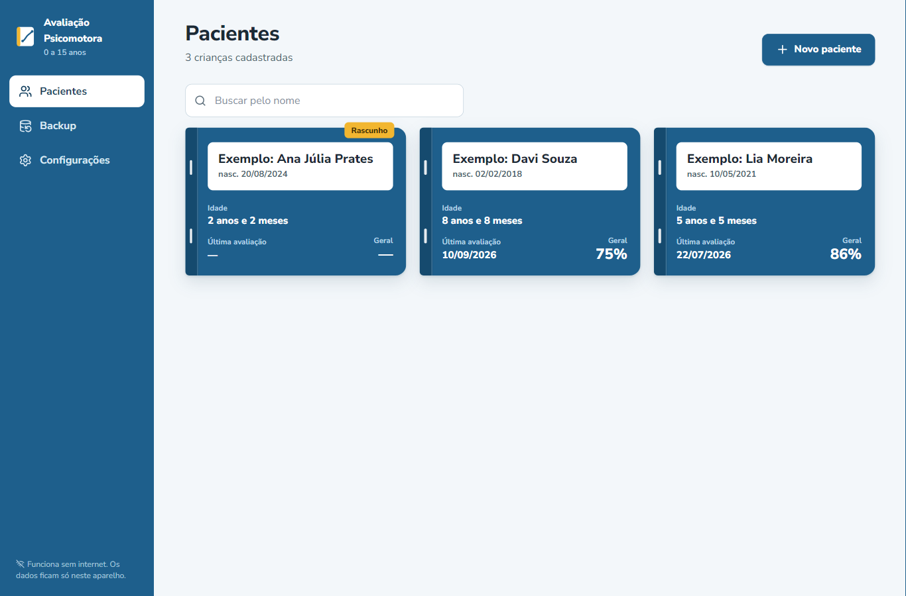 | 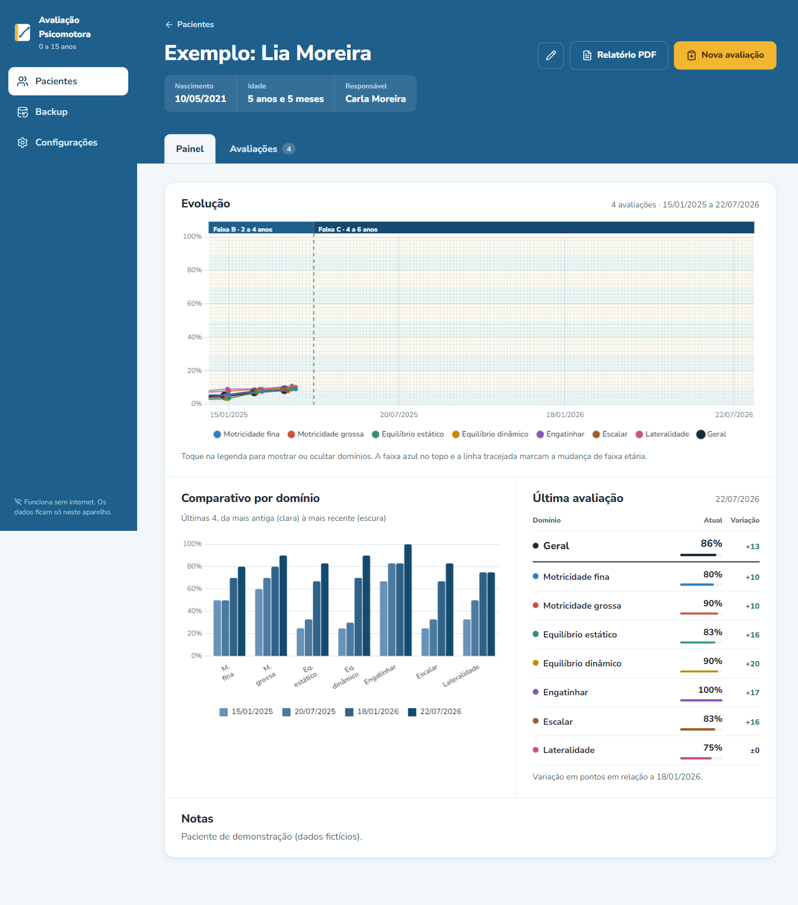 |

| Assessment in progress | PDF report |
| --- | --- |
| 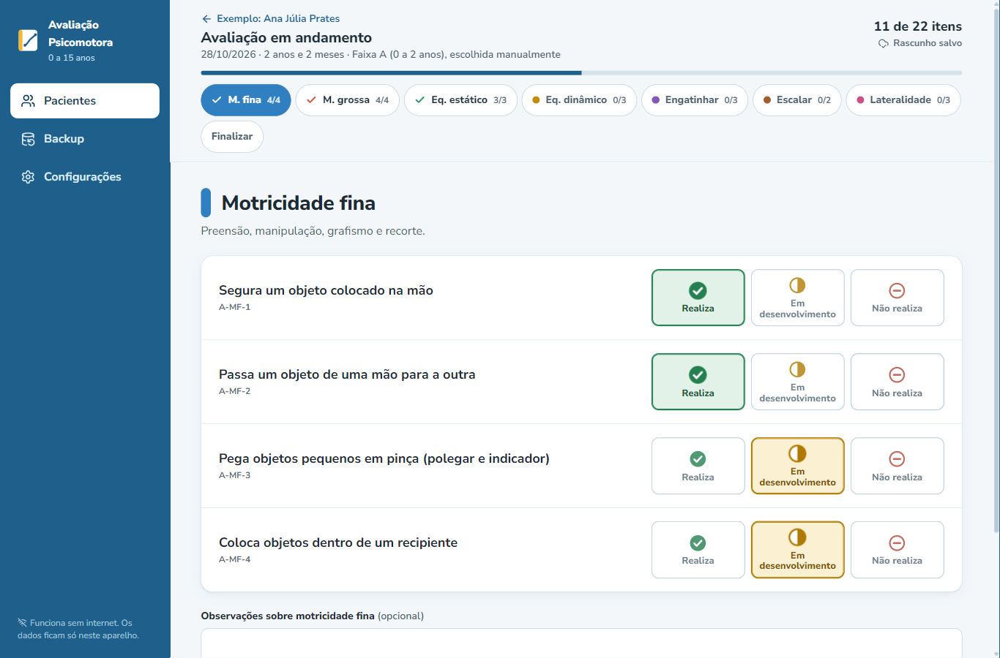 | 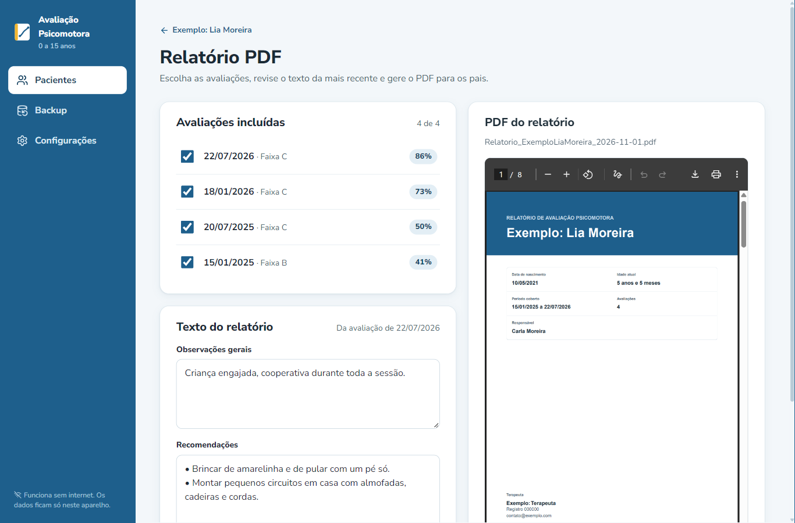 |

### Tablet

| Patients | Dashboard | Assessment |
| --- | --- | --- |
| 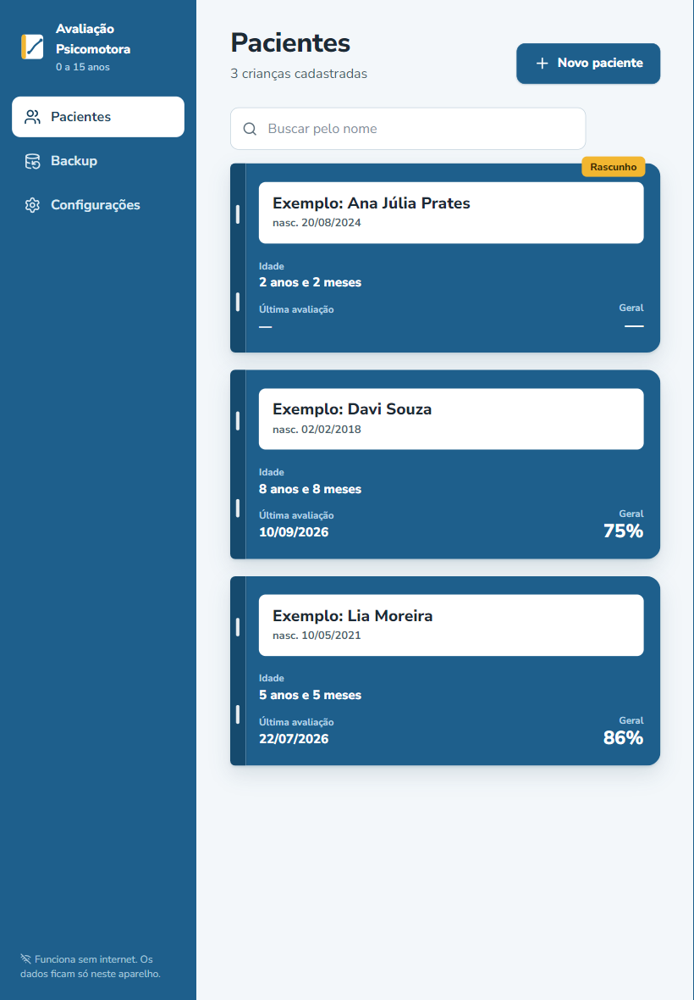 | 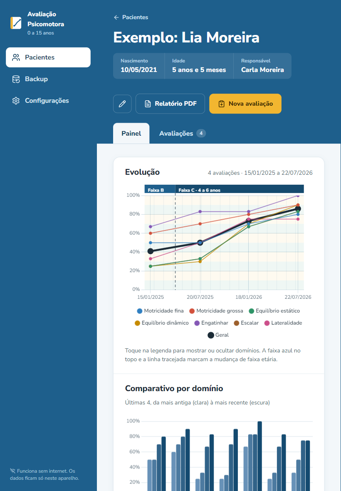 | 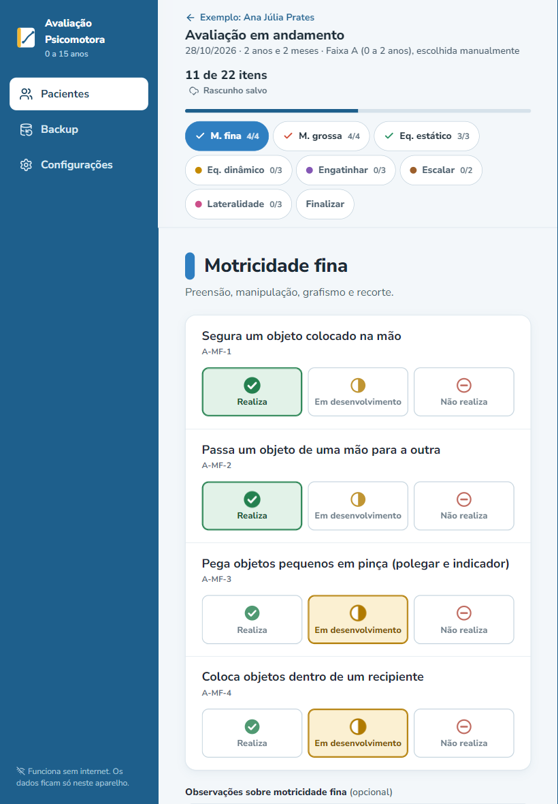 |

### Mobile

| Patients | Assessment | Evolution | Report |
| --- | --- | --- | --- |
| 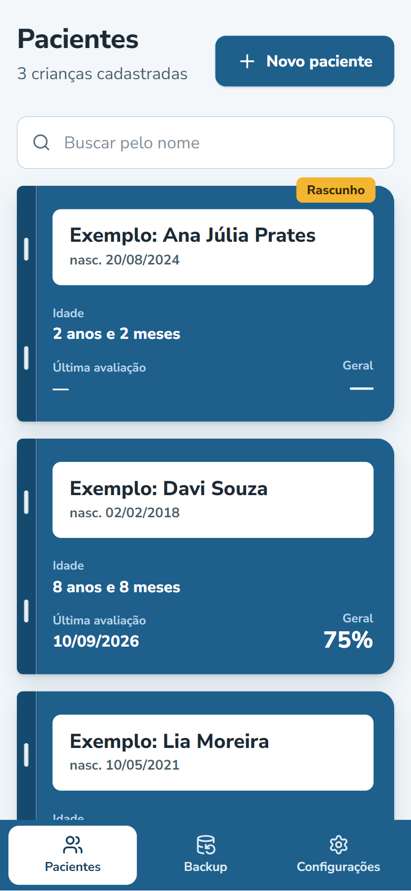 | 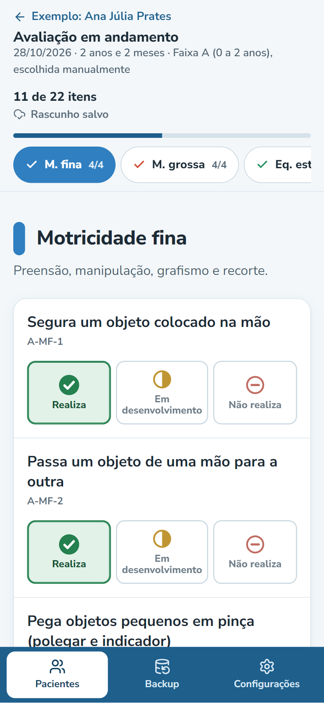 | 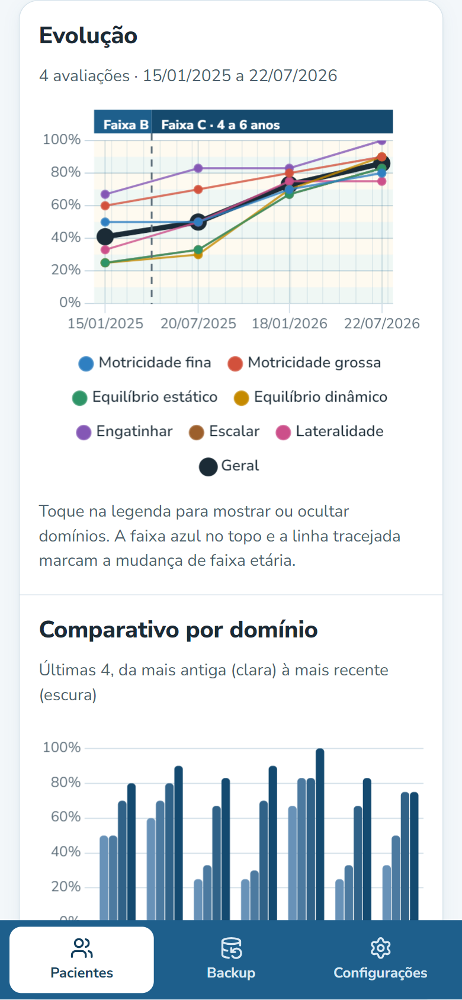 | 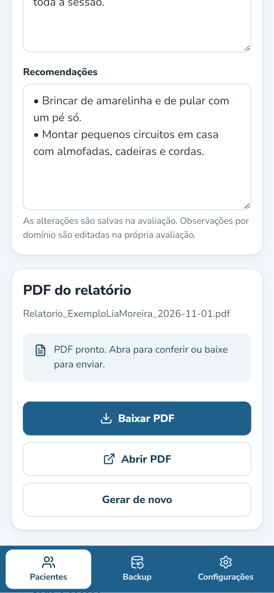 |

## Install the app (PWA)

Open **https://avaliacao-psicomotora.vercel.app** once while online, then add it to your device. After that it opens from its own icon and works without internet.

### iPad / iPhone (Safari)

1. Open the link in **Safari** (other iOS browsers can't install web apps on older iOS versions).
2. Tap the **Share** button (square with an arrow).
3. Choose **Add to Home Screen** (*Adicionar à Tela de Início*), then **Add**.

### Android tablet / phone (Chrome)

1. Open the link in **Chrome**.
2. Tap the **⋮** menu.
3. Choose **Install app** (*Instalar app*) or **Add to Home screen**, then confirm.

### Computer (Chrome or Edge)

1. Open the link.
2. Click the **install icon** at the right end of the address bar (or menu → *Install Avaliação Psicomotora*).

### Good to know

- **Updates:** a new version downloads in the background. Close the app completely and reopen it to see it.
- **Data is per device and per browser.** Patients entered on the computer do not appear on the tablet. To move data, use *Backup → Exportar* on one device and *Backup → Importar* on the other (import replaces all data on that device).
- **Clearing the browser's site data deletes everything.** The app reminds you to export a backup every 5 completed assessments. Keep backup files somewhere safe — they contain children's health data.
- **Your logo and details** for the PDF cover are set in *Configurações*.

## Development

Stack: React + TypeScript + Vite, `vite-plugin-pwa`, Dexie (IndexedDB), Chart.js, `@react-pdf/renderer`, zod, Vitest.

```bash
npm install
npm run dev        # development server
npm run build      # type-check and production build into dist/
npm run preview    # serve the production build (service worker active)
npm run lint       # oxlint
npx vitest run     # unit tests (age bands, scoring, backup round-trip)
```

The questionnaire lives in [`src/data/questionario.json`](src/data/questionario.json) (5 age bands × 7 domains, versioned). Scoring rules are in [`src/lib/domain.ts`](src/lib/domain.ts). The visual system is documented in [DESIGN.md](DESIGN.md).

### Deploy

The app is a static site. It is deployed to Vercel:

```bash
npx vercel@latest deploy --prod --yes
```

Any static host works (Netlify, GitHub Pages); it must be served over **HTTPS** for installation and offline mode to work.
